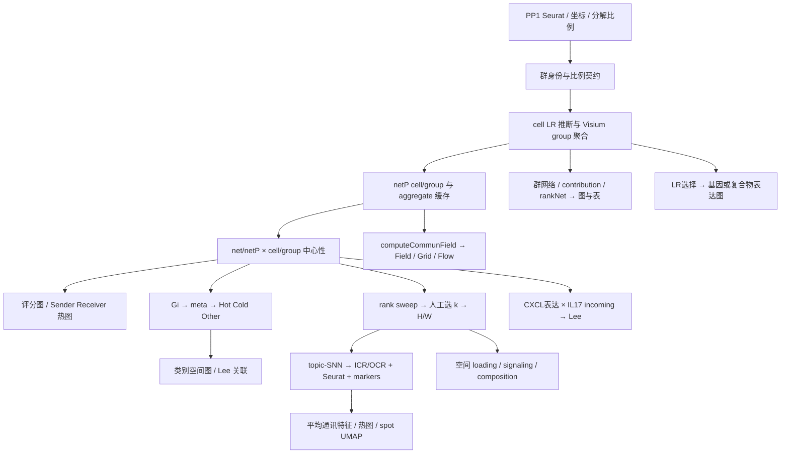

# PP1 下游调用方审计、重构与测试方案

> 2026-10-21；研究对象：[visium_PP1.R](../tests_dev/test_data/visium_PP1.R)。
> 状态：**方案，未实施迁移**。扩展 [语义契约提案](../.agents/notes/proposed/2026-10-20-downstream-communication-semantics-contract.md)、[分析语义卡](ANALYSIS_SEMANTICS.md) 与 [可视化语义卡](VISUALIZATION_SEMANTICS.md)，不替代父审计的全部消费者范围。
> 下文区分脚本实参、当前源码行为、建议契约和已执行证据。未执行后果标 `[INFERENCE]`；§6 是待实施验收，§7 才是本轮运行结果。本轮不改 R 实现、原 PP1 脚本、API 帮助页或依赖。

## 1. 结论与边界

PP1 不是若干独立绘图调用，而是**结果被再次消费的多条工作流**：中心性生成图与 topic；Gi 写 metadata 后分类，再输入 Lee；topic 生成社区、markers、Seurat assay 和 UMAP；rankNet 的图数据还被导出 CSV。只验证返回 class 会漏掉绝大多数链级错误。

新增的关键约束：

- **上游不闭合**：真实输入有 905 spots；脚本选择的 `final.clusters.sub` 有 9 类，合并后的分解矩阵只有 6 类。`Chat.re` 在首次读取前没有生产步骤；下游加载的 `PP1_relabel.rds` 未在当前 `tests_dev` 资源中找到。不能声称从原脚本一键复现。
- **Visium 不是普通硬标签聚合**：当前 `computeAvgCommunProb_Visium()` 仍读写旧网络，不能直接换成 `computeAvgCommunProb()`。前者使用混合比例，置换的是比例矩阵的群列；后者有另一套支持门控和置换契约。
- **存在社区实现，不是缺少算法**：`identifyTopicCommunities()` 是当前公开实现；真正缺口是旧 niche API 的历史等价性、最终 schema 的 Seurat 桥接、通讯 assay 量纲、状态一致性和全链验证。禁止用网络 `netClustering()` 或另写 KMeans 代替。
- **三个“0.05”不是同一件事**：LR/group 的 p 门限、表达 `cutoff`、Lee L 的显示 cutoff 分属不同量；热点分类的局部 p 门控又发生在 Gi 之后。
- **保留已经正确的落点**：`netP$pathways/pathways.cell`、`centr/centr.cell` 当前仍在 net/netP 根部。不是所有根部字段都是遗留结构。

## 2. 工作流依赖与输入契约

### 2.1 可复现入口，而非执行原脚本的所有副作用

[PP1:1–76](../tests_dev/test_data/visium_PP1.R#L1-L76) 含 `rm(list=ls())`、未定义的 `setpwd()`、macOS 绝对路径、Windows conda 路径；[212–243](../tests_dev/test_data/visium_PP1.R#L212-L243) 首次 `Chat.re <- netAnalysis_computeCentrality(Chat.re,...)` 依赖外部会话状态。建议未来提供显式输入/输出目录、明确 checkpoint 的受控执行入口，不在测试中 source 整个历史脚本。

`SpatialCellChat`、`VisualizeChat` 和限定的 `SpatialChat::` 混用，不能保证实际调用本仓库函数。本轮 source 当前源码检查，不以已安装同名包替代工作树；迁移时统一当前包命名并更新全部调用方，不加旧包/旧函数名 shim。`createSpatialCellChat(assay="Spatial")` 当前可以通过 R 的部分参数匹配落到 `assay_name`，不是已证实的 unused-argument 错误；建议调用方改为完整参数名，分别显式说明 assay 名称与 `input.assay="norm"`。

### 2.2 群定义、混合比例与 Visium 专属生产者

[PP1:18–44,65–72,144–150](../tests_dev/test_data/visium_PP1.R#L18-L150) 实际操作：去掉 predictions 最后一行 `max`；合并 TC/MYL 为 Immune；小于 .1 的比例置零；创建 `final.ident`，但创建 Chat 时选择的是 **`final.clusters.sub`**。

本轮真实数据观察：

- `final.clusters.sub`：Basal、EG、ENDO、FIB、MYL、SM、Spinous、Supraspinous、TC；9 类。
- 分解矩阵列：Keratinocyte、EG、ENDO、FIB、SM、Immune；6 类。
- 截断后的比例和范围约 `[0.754186,1]`；635/905 行与 1 相差超过 `1e-8`，但 `round(rowSums(D))!=1` 为零行。原检查不能证明归一化。

[Visium 入口](../R/modeling.R#L738-L942) 要求 D 的列与 `levels(group)` **同名同序**、行与 coordinates 同序；随后仍读取 `net$prob.cell`、`net$tmp$prob.cell`，写旧 `net$prob/pval` 和 `options$parameter`。现有合法 `net$cell$prob` 会被误报为尚未推断。

[两个 Visium 单层 helper](../R/modeling.R#L957-L1007) 的定义为：令 D 为 spot×type 比例，B=1[D>0]，P 为 spot×spot 权重，E 为把 P 的已存储条目置 1 的矩阵：

- sum：`t(D) %*% P %*% D`；
- avg：上述量逐项除以 `t(B) %*% E %*% B`，NaN 置零；显式存储零也进入 E；
- permutation：置换 D 的**群列**，`nboot=100, seed.use=1`，以 `Pboot>Pobs` 比例产生 p；不是置换 spots/独立样本。`colocalization.use=FALSE` 为默认。

**建议而非已批准的科学变更**：优先评估按脚本已有六类 `final.ident` 与六列 D 对齐的方案；若需要 KC 亚型等九类，必须提供对应分解定义，不能拆复制已有 Keratinocyte 比例。是否将截断后的比例重新归一化、是否改变群列置换/null model，均独立裁定。不能自动改成 one-hot 或普通 `computeAvgCommunProb()` 来让管线运行。

### 2.3 四类网络与坐标身份

[生产者](../R/modeling.R#L1659-L1797) 保留 `netP$pathways`（group）与 `pathways.cell`（cell），可能集合和排序均不同。[aggregateNet](../R/modeling.R#L2311-L2455) 把 LR.sig 写入 `net$group/cell$LR.sig`；旧选择 helper 仍消费另一层级的缓存。表与图必须记录真正使用的层域，不能从 `LRsig[1:5,]` 或 group pathway 列表推定所有 cell 图都存在这些层。

建议固定四组中间结果：LR cell/group、pathway cell/group；中心性分别写当前 `slot$centr.cell` 和 `slot$centr`。角色图只请求 outdeg/indeg，**PP1 不需要为此启用全量中心性**；当前 `degree.only=TRUE` 的五项包含这两项和 PageRank。

[PP1 坐标变换](../tests_dev/test_data/visium_PP1.R#L47-L55) 可代数化为 `(imagecol-min(imagecol), imagerow)`；后续旧空间图还交换两列、反转 y。必须记录分析坐标、物理 ratio/tol、raster transform 的区别，以不对称 landmark 核对各图同一 spot；不能把每个图再任意翻转到“看起来对”。

## 3. 逐调用 IO 与关键参数

下表列科学含义、返回和链级行为相关的参数；颜色、字号、面板宽高仅列影响解读或导出的差异。完整 formals 以所链源码为准；建议参数显式化并不表示本轮批准修改函数默认值。

### 3.1 评分、群网络与导出表

| PP1 调用 | 输入、实际参数/默认 | 输出及下一消费者 | 重构要点 |
|---|---|---|---|
| [246,335,404,419](../tests_dev/test_data/visium_PP1.R#L245-L310) `spatialDimPlot` | images、idents 或 `meta[[group.by]]`；`point.size=1`，默认 `image=TRUE` | ggplot → cowplot/PDF | 区分 raster 坐标与评分图分析坐标；Hotspot/ICR 列必须真实生产，不伪造填充 |
| [255–268](../tests_dev/test_data/visium_PP1.R#L250-L269) `spatialVisual_scoring` | `centr.cell[measure,spot,layer]`；pathway 用 netP、LR 用 net；`do.group=FALSE,do.binary=FALSE`；merge 时默认 outdeg+indeg | 未 merge 且 combined=TRUE 返回 patchwork；merge 返回 ggplot；不修改 Chat | 单 measure、双 measure、Both 的均值/分色分别核对；group path 列表不应隐式充当 cell 选择器。[源码](../R/visualization.R#L724-L932) |
| [276](../tests_dev/test_data/visium_PP1.R#L271-L279) `netVisual_aggregate` | group LR+注释；`layout="circle"`；默认 `thresh=.05,top=1`；edge.width.max=2、vertex.size.max=1 | 当场绘图并返回 recordedplot，脚本不接收返回值 | LR 实时 `p>thresh` 求和不是 netP 缓存替换；注释中的 spatial 布局不是本脚本已执行路径。[源码](../R/visualization.R#L1440-L1545) |
| [287](../tests_dev/test_data/visium_PP1.R#L281-L290) `netAnalysis_signalingRole_network` | group `netP$centr`；明确 `measure=c("outdeg","indeg")`、Sender/Receiver；width=6,height=1 **cm** | 内部 draw；实际返回 NULL。PDF 设备宽高使用 **inch** | 行内最大值缩放，不能跨 pathway 比绝对量；cluster.cols 实际复用 cluster.rows 的问题另修；无需全量 flowbet/info。[源码](../R/analysis.R#L2633-L2673) |
| [296,301](../tests_dev/test_data/visium_PP1.R#L292-L303) `netVisual_heatmap` | group LR/pathway prob；slot.name 显式；默认 remove.diagonal=FALSE；LR 默认 thresh=.05 | 内部 draw 的结果，非普通 ggplot；被 PDF 设备消费 | 仍读 options/mode 和旧 prob；核对 LR 与 netP 门控差异；不可只检查能构造 Heatmap。[源码](../R/visualization.R#L2734-L2911) |
| [308](../tests_dev/test_data/visium_PP1.R#L305-L311) `netAnalysis_contribution` | 默认 group、thresh=.05、return.data=FALSE；pathway 内 LR | ggplot → `gg$data` 行数决定文件高度 | 当前 min–max 份额不是 raw 份额；图数据不是稳定的排版计数 API，零条/分区/空结果另裁定。[源码](../R/analysis.R#L259-L397) |
| [345–359](../tests_dev/test_data/visium_PP1.R#L343-L359) `rankNet` | `mode="single",slot.name="netP",measure="weight"`；默认 group、thresh=.05、show.raw=FALSE、do.stat=FALSE | ggplot；图数据包含 name/contribution/contribution.scaled/group；CSV 排 raw contribution | 实际行是 pathway，不是文件名所称 LR；single 没有 enrichment 检验。建议用核定的 return.data 表契约导出，不能把 list 当 data.frame。[源码](../R/analysis.R#L445-L554) |

rankNet 的 `signaling.type` 先从 DB annotation 取得 pathway 成员名单，再筛选**已经求出的完整 pathway 总量**。跨两类 annotation 的同一 pathway 可重复出现在两个 CSV 分区，并不等于分别重算类别专属 LR 总量；single 的该参数还覆盖 signaling/pairLR 选择，不是求交集。[对应实现](../R/analysis.R#L497-L548)。图使用 scaled，而 CSV 按 raw 排序，两者须明确分列；空类别不能继续用标量 `df$type <- ...` 假设有行。

### 3.2 Gi → metadata → 热点类别 → Lee

| 入口 | 参数/数据契约 | 输出、下游依赖 |
|---|---|---|
| [PP1:320–325](../tests_dev/test_data/visium_PP1.R#L313-L329) `spatialGiPlot` | `slot.name="net",signaling.name=idx.*,measure="indeg"/"outdeg"`；默认 **do.binary=TRUE,n=12,gstar=FALSE,method="normal",p.value=NULL** | 默认返回更新 Chat 并显示图；return.object=FALSE 返回图。PP1 只把前两次 incoming 赋回 Chat，后四次图调用不会把 outgoing 存回调用者 |
| [Gi wrapper](../R/visualization.R#L8841-L9064) | numeric selector 索引 **centr.cell 第三轴**；默认输入为各 spot 的正中心性 LR **层数**，不是加权总强度；measure.name 会被规范化 | plot.title 同时决定持久化列名，非纯美观参数；show.plot=FALSE 仍构造图并做统计，不能当“无绘图计算 API” |
| [Gi helper](../R/visualization.R#L9087-L9142) | 需要三列 x/y/score、n 与分组；kNN、style B、localG；Gi* 含自己。wrapper 默认 n=12，不是 helper 的默认 | computation 返回 statistic_G 与 internals；normal 是 ggplot、3d 是 plotly。p.value=NULL 仍可计算 p，只是不进行显著点形区分 |
| [PP1:332–336](../tests_dev/test_data/visium_PP1.R#L331-L341) 分类 | `G*(p<.05)`；正→Hot、负→Cold、其余→Other；G/p 为 NA 仍为 NA，`p==.05` 属 Other | 产生 meta$SecretedHotspot；供 spatialDimPlot 和 Lee。局部原始 p 未进行跨 spot 校正，不可称已控制 FDR |
| [PP1:340](../tests_dev/test_data/visium_PP1.R#L338-L341) `spatialLeePlot` | group.by1 默认 idents；group.by2=SecretedHotspot；默认 **lw.type="Itself"**；cutoff.Lee=.05；y.levels=Hot/Other/Cold | 默认返回**未 draw 的 Heatmap**。本调用问的是同 spot 类别关系，不是周围邻居富集；.05 为 L 显示门限，不是显著性 p |

当前 Gi 键由 `make.names(paste0("Getis-Ord Gi ",feature.name))` 和带 `P` 的版本生成。`plot.title="Secreted Signaling"` 正好对应脚本消费的 `Getis.Ord.Gi.Secreted.Signaling`、`Getis.Ord.Gi.P.Secreted.Signaling`；Cell-Cell Contact 使用不同键。但同一标题下双 measure 会覆盖同一键，标题规范化碰撞也会覆盖；键没有编码 binary/n/层集合/Gi*。[源码](../R/visualization.R#L8951-L9005)。建议先核定统计结果身份与标题分离的持久化方案，再迁移调用方；不能简单保留覆盖缺陷。

已观察到**最终 matrix 坐标＋单 measure＋单 signaling** 的 wrapper 输入形状失败。源码中 centr 子集已有 `drop=FALSE`；风险是 `cbind(coords,centr.sum)` 得 matrix，随后以 data.frame 风格单下标选三列。[定位](../R/visualization.R#L8892-L8911)。不应将其归因为“只支持多层”或通过改单层特例修补。Gi* 还需验证固定读取无星号 p 列的问题。

PP1 的 Lee 类别图中 wrapper 把 group.by2 传 x、group.by1 传 y；最终 **data 为 idents×热点，heatmap 为热点×idents**。`y.levels` 在这里正确地控制纵轴 Hot/Other/Cold。不能误报为该脚本 y.levels 用错；仍需覆盖非方阵及缺类别。[源码](../R/visualization.R#L8409-L8425)、[转置与 levels](../R/visualization.R#L8684-L8716)。

### 3.3 Niche → 当前 topic/community/Seurat API

以下是当前职责对应候选，**不是旧 SpatialChat 版本等价性已获证明**；五个历史名称当前均无定义/export。不能只修改函数名：

| PP1 历史调用/键 | 当前候选与参数映射 | 当前 IO |
|---|---|---|
| identifyNichePrograms，370/374 | `identifyCellTopics`；nmf.k→topic.k，nmf.p→prop，nmf.maxit→maxit；注释分支 nmf.cv.reps→n.reps | LR/pathway×spot 中心性输入；sweep 写 `slot$tmp$suggestK[[pattern]]` 的 stats/figure；单 k 写 `slot$topic[[pattern]]$cell`（spot×topic H）及 signaling（layer×topic W）；返回 Chat |
| identifyNicheCommunities，375 | `identifyTopicCommunities`；PP1 的 resolution=.1、clustering.method="seurat"、spatialWeight=.5、logfc.threshold=.02、return.seurat=TRUE 均有形参 | 中心性+H/W→Seurat topic-SNN→社区与 markers；返回 Chat，不直接返回 Seurat。srt 在 `slot$topic[[pattern]]$seurat.obj` |
| `$niche$incoming$seurat.obj`，391/469 | `$topic$incoming$seurat.obj` | srt 含 group.cellchat、label.ICR、Idents、misc$markers_label.ICR；Chat 的 meta$ICR 写入社区，**Chat@idents 不变** |
| RunUMAP(reduction="nicheIn",dims=1:12)，403 | reduction 候选 `topicIn`；outgoing 为 topicOut | Seurat embeddings=H、loadings=W；UMAP 行是 spot，不是信号网络。不能改用 netEmbedding/netClustering |
| spatialNichePlot(niches=NULL)，434 | `spatialTopicPlot(topics=NULL)`；PP1 point.size=.1,ncol=6；默认 combine=TRUE | H+坐标→patchwork；combine=FALSE 为 ggplot list |
| netVisual_NicheLoadings，451 | `netVisual_TopicSignaling`；nTop=10、默认 nfeatures=30；feature_cat=NULL 当前选择默认 LR-pair | W→loading 排名图，不是 markers 表；先 top features 再聚合；返回 patchwork/list |
| netVisual_NicheComposition，394/468/478 | `netVisual_TopicComposition`；nicheIn→topicIn；三处分别消费社区×原群、社区×topic、原群×topic | Heatmap 或 ggplot；默认 scale.rows=TRUE，FALSE 也会做列归一化；trim=.1 是非零支持比例门控，不是截尾均值；SCC topic 分支硬读 net，无 slot.name |
| AverageExpression→doHeatmap，411–415 | 显式选择**通讯特征** assay、层、group.by 与统计定义 | 平均对象→scale.data 热图；marker 表的 gene 列在这里是 LR/pathway 特征名，不一定是基因 |

源码：[topic 拟合](../R/analysis.R#L3467-L3557)、[社区完整链](../R/analysis.R#L3595-L3790)、[桥接器](../R/utilities.R#L712-L761)、[composition](../R/visualization.R#L4766-L5038)、[loadings](../R/visualization.R#L5072-L5294)、[topic 空间图](../R/visualization.R#L7123-L7267)、[doHeatmap](../R/visualization.R#L9471-L9567)。

**当前社区参数的实际控制范围**：

- PP1 `topic.k=12` 是选定 topic 数，`resolution=.1` 决定社区划分；两者不等价。sweep 的 `4,6,…,20` 不会自动选出 12；当前建议 k 图为训练后抽样重建误差，不是留出交叉验证（A-15）。
- `nPrograms=NULL` 使用全部 topic，`k.signaling=20,prune.SNN=1/15` 控制 topic 邻域；默认 algorithm=1 是 Louvain，不是 Leiden。PP1 显式 resolution 跳过自动扫描。
- **seurat 分支不使用 spatialWeight=.5**。该参数用于 weightStardust；autoStardust 与 fusion 各有不同空间组合。不能宣传此 PP1 调用“50% 空间权重”。
- `logfc.threshold=.02` 仅用于 markers，不改变 NMF 或社区划分；默认 min.pct=.1。`seed.use=666` 当前未在社区函数体传递，不能假称已保证可重复。
- 默认 do.plot=TRUE 会额外保存社区热图/空间图；do.plot=FALSE 仍计算 markers。return.seurat=FALSE 不提供本次 markers 的独立返回路径，且不清除已存旧 srt。
- 非默认 graph.name 未参与最初 FindNeighbors；Stardust/fusion 的普通距离 matrix 传入 FindNeighbors 未显式声明预计算距离。`[INFERENCE]` 可能按距离剖面再次计算邻居；属于独立算法审阅，不随存储迁移悄改。

**Seurat 不是中性的容器**：社区代码把原始中心性 counts 原样放入 `CreateAssayObject(data=...)`，再 ScaleData/FindAllMarkers。项目 Seurat 4.4.0 的 AverageExpression(data) 会先 expm1；本轮确认原均值均为 1 的两组得到 3.19452805 与 1.71828183，marker avg_log2FC 也非零。该替换后的 counts 是空层，不能只改 `slot="counts"` 解决。需先决定原量存储层、变换、marker 效应量和组均值定义；不得默认套 RNA library-size normalization。版本依据：[Seurat 4.4 AverageExpression](https://raw.githubusercontent.com/satijalab/seurat/v4.4.0/R/utilities.R)、[FoldChange](https://raw.githubusercontent.com/satijalab/seurat/v4.4.0/R/differential_expression.R)。

**跨调用状态是验收对象**：单 k 重拟合替换 topic，却不清 meta$ICR/OCR；net 和 netP 社区复用同一 meta 键；PP1 局部 srt 的 RunUMAP 没写回 Chat，保存 Chat 不会保存这次局部修改。建议明确重拟合失效规则、按网络/方向区分身份以及 Seurat 写回时点，不允许新 H/W 搭配旧 labels/markers。

PP1 的 `top10` 实际是 `top_n(n=5)`，并列可超过五条，doHeatmap 又全局去重。未来明确 top-k、并列/稳定排序、重复 LR、空 markers；不按变量名推断“每社区十个基因”。

历史证据限制：工作树/教程与初始 clone 已采用 topic 名称；较早 [Slide-seq 实验](../tests_dev/test_data/Slide-seq.R#L729-L830) 的 identifyCommunicationNiches 返回与存储也不同。尚缺 PP1 当时 SpatialChat/VisualizeChat 的精确版本和实现，不能承诺旧 API 数值等价。

### 3.4 通信场、表达图与连续变量 Lee

| PP1 调用 | 当前实际 IO/参数 | 必须明确的边界 |
|---|---|---|
| [491](../tests_dev/test_data/visium_PP1.R#L488-L525) computeCommunField | netP cell prob；signaling.name 取 pathways.cell 前六；top=.8，默认 sparse=TRUE；写 `cell$field$incoming/outgoing` 并返回 Chat | top 是按每节点累计权重选边，不是正边数量比例或 p 阈值；两方向都计算。0/1/少于六层不能产生 NA 名称 |
| 499 Flow | incoming；grid.resolution=4L；默认 grid.field.mean="median"；输入新 cell$field，返回 ggplot | 4 是网格分辨率倍数，不是“4微米”；并非 mean；脚本裸调用未显式 print/save，在 source 模式不能当已出图 |
| 507 Field | incoming、zoom.mode=FALSE、arrow.length=.2、point.size=.5；仍读旧 root field | producer 成功不代表基础消费者可用；实际新对象已重现拒绝；不把 field复制回旧根部作 shim |
| 517 Grid | **outgoing**、arrow.length=.05、point.size=.5；返回 ggplot | 不是 Flow incoming 的同量对照。zoom.mode 不是正式参数，经 `...` 转给 metR::geom_arrow；不能认为它控制网格裁切，是否 warning 需实际依赖验收。[源码](../R/visualization.R#L5810-L6090) |
| [532](../tests_dev/test_data/visium_PP1.R#L528-L539) spatialFeaturePlot(pathway) | do.group=FALSE、do.binary=FALSE、cutoff=.05；默认 enriched.only=TRUE；表达/metadata 输入 | group pathways 前五被用于 cell enriched 选择，需名称域核对；cutoff 是表达门限而非 p。length(patchwork/ggplot) 不能作为稳定面板数契约 |
| 535→537 extractEnrichedLR→spatialFeaturePlot(binary) | 取循环退出后**最后一个 pathway**，再取返回 LR 表第一行；do.group=FALSE,cutoff=.05 | 明确 pathway 与 LR 选择，覆盖零行；复合物需按现行几何均值，而非任取亚基；空 LR/非空 gene 的缺陷不得保留 |
| [544–548](../tests_dev/test_data/visium_PP1.R#L542-L561) CXCL 与 IL17 提取 | 期望 mat1=spot×gene、mat2=spot×LR；表达仍读已删除 @data，LR 来自 centr.cell indeg | 显式选 norm/signaling/smooth 的科学来源；gene/LR 零匹配、单匹配必须保维并保留名称，避免 singleton 转 numeric 触发 Lee dot 分支 |
| 553–560 自定义权重→Lee | MERINGUE 图转换 lw 后**没有传入** spatialLeePlot；实际使用 lw.type="interaction.range"，默认 interaction.range=250/contact.range=10，ratio/tol 取对象 | 构造了 lw 不代表使用它。若保留自定义邻域，必须显式传 lw 并对齐；若保留内部半径，删除误导性的未用计算。两者科学问题不同，先裁定。Lee 只取 L，无显著性检验 |

场的源码：[生产](../R/analysis.R#L4016-L4168)、[基础图](../R/visualization.R#L5477-L5740)、[Flow](../R/visualization.R#L6153-L6448)；表达：[选择/连续](../R/visualization.R#L437-L579)、[binary](../R/visualization.R#L580-L694)；Lee：[邻域](../R/visualization.R#L8368-L8548)、[统计与返回](../R/visualization.R#L8580-L8816)。

## 4. 调用方问题索引与需要裁定的选择

| ID | 问题/依据 | 建议与裁定边界 |
|---|---|---|
| PP1-01 | namespace、机器路径、Chat.re/checkpoint 来源；§2.1 | 先闭合受控入口；不能凭未知旧 RDS 宣称可复现，不修改用户原文件 |
| PP1-02 | 六列 D 对九群、比例截断、Visium 老存储；§2.2 | 推荐保持混合比例分析问题，先核定群映射/剩余质量/null model；拒绝静默硬标签替代 |
| PP1-03 | LRsig、prob、centr 第三轴与 group/cell pathway 集不同；§2.3 | 按名字选择并报告缺失；不靠无断言的 all()、位置或 `[1:n]` 保证身份 |
| PP1-04 | Gi 默认是层支持数、matrix 三列表构造失败；§3.2，V-011 | 修数据形状；显式 binary/n/Gi*；统计定义变更单独裁定，不做单层特判 |
| PP1-05 | title 同时是持久化键，覆盖/NA/原始局部 p；§3.2 | 统计身份与显示标题分开；核定同标题多 measure 与缺失结果；不自动补 p=0/NA→Other |
| PP1-06 | Lee Itself 与邻域的含义、自定义 lw 未传、singleton；§3.2/3.4，V-012 | 选择真实所需权重及空/NA策略；明确 data/plot 轴，不加暗中自动重排 |
| PP1-07 | pathway 冒称 LR、category 成员过滤、raw/scaled；§3.1，A-05 | 建立数值表→图/CSV共同数据来源；是否按类别重聚合是独立科学变化 |
| PP1-08 | 五个 niche API 的当前候选与历史等价证据缺口；§3.3 | 迁移真实 topic/community 完整链，不能用三张图或 netClustering 代替 |
| PP1-09 | 原始通讯量被当 log-data、marker/平均对象量纲；§3.3 | 先定义 assay 层与效应量；保留特征原名、审阅 Seurat 版本，不用改一个 slot 蒙混 |
| PP1-10 | 社区 seed/graph.name/空间参数和旧状态；§3.3 | PP1 seurat 分支先闭合；其它公开分支明确未验收，逐分支核定算法与状态失效 |
| PP1-11 | field 新生产旧消费、top/grid/direction 与表达选择链；§3.4 | 分别迁移 field 消费者与 LR选择链；图名不替代数值轴，crop/速度不改变科学量 |
| PP1-12 | Heatmap/ggplot/recordedplot/list/Chat 的文件生命周期 | 每种返回显式 draw/print/replay/保存；临时输出目录与 dev.off 清理；不拿文件存在或非零大小当图形正确证据 |

以上 ID 是调用方问题，不替换已有 A-*/V-*，也不是已批准的新 API。字段/key/默认值变化须更新关联 proposed Note、全部调用方与帮助页后实施。

## 5. 细化迁移批次与完成门禁

这些批次细化 Phase 4/5，不缩减父迁移审计中 individual/plotly、比较分析等范围。独立已核定路径可先迁移；**PP1 整链验收不能跳过 Visium 或社区子链**。

| 批次 | 实施范围/顺序 | 必须交付与退出门禁 |
|---|---|---|
| B0 输入与复现 | 先关闭 PP1-01/02：namespace、真实数据/检查点、群定义、D 对齐；规划 Visium producer 的新结构写回及参数存储 | 有明确数据来源、归一化/群名契约与 Visium 数值对照；raw fixture 不冒充通信 checkpoint。无需为验证下游先重跑整个昂贵推断，可用下述独立 fixture |
| B1 共享轴与已可用路径 | 稀疏逐层访问、LR注释 join、group/cell 层选择、四类中心性；评分和两指标角色图 | 名称置换/缺层行为明确，保留 centr 根部；已有可用图不因全量迁移被回归；不预建万能读取框架 |
| B2 LR选择与表达展示 | extractEnrichedLR*、缓存选择、空集、complex 与 assay；spatialFeaturePlot 和 plotly_spatialLRpairPlot 及其调用方 | signaling/pair/features 全路径；当前阈值 vs缓存分别核定；实际 ggplot 与 browser 验证，不只 features=成功 |
| B3 群网络和数值表 | aggregate/individual 四布局、heatmap、contribution、rankNet single+表导出；比较分支按父计划独立继续 | LR实时/缓存差异有解释；p 等号、正边/存储零、category重叠、raw/scaled、返回表与图一致；recordedplot 可重放 |
| B4 热点与 Lee 两链 | Gi三列表、按名LR选择→Gi/p持久化→分类→空间图→Lee；另做CXCL×IL17及权重入口 | 修形状不暗改binary；唯一统计身份、NA、Gi*、非方阵/单变量、实际PDF绘页及正确轴；spdep缺失不得记通过 |
| B5 topic 与社区完整链 | 先 CellChat2Seurat 与通讯 assay，随后 rank sweep/固定 k→identifyTopicCommunities→markers/均值/热图→三类topic图→spotUMAP→持久化 | H/W/labels/markers/srt同源同名；seurat分支参数真正生效；重拟合失效与net/netP隔离；无历史证据时不承诺旧版等价；其它三算法分支单独审阅 |
| B6 场消费者 | current cell$field→基础Field/ZoomIn、Grid/Flow；复用现有网格与widget语义，不把缓存复制回旧位置 | 零净向量正mass、有效域、median/sum、方向/朝向、top边界；Grid无正式zoom.mode不能借...伪装支持 |
| B7 PP1受控端到端 | 使用已核定输入和迁移后入口；更新脚本/教程/Rd/状态文档，保存并重新加载最终对象 | 整条链、CSV及所有实际图逐项留证；把缺依赖/未裁定分支标阻塞，不把部分成功称为完整PP1验收 |

实施时每批一个集成负责人，按“生产者→消费者→文档/调用方→验收”切换；B2/B3/B4/B6 可在 B1 的共享契约稳定后独立推进，B5 的 assay 与社区争议只阻断该链，不拖住已核定表达图。不要顺带改变阈值、统计方法或引入旧兼容 slot。

## 6. 测试方案：fixture、断言与真实图形

以下全部是**后续实现的测试设计**，不是本轮测试通过清单。优先扩展现有脚本；仅在缺少合适归属时新增行为测试，不编写源文本/函数名存在/简单转发/默认常量快照测试。

### 6.1 四层 fixture

| 层 | 输入与构造 | 允许证明什么 / 不允许替代什么 |
|---|---|---|
| F0 可手算语义层 | 2–4 spots、2–3群；显式稀疏P及D、正负/阈值例子；单/多LR、复合物零亚基 | 归约、分母、名称对齐、边界的独立数值 oracle；不证明空间统计或NMF端到端 |
| F1 最终11-slot链级 | 至少36 spots、3不等大群；不对称二维坐标；≥6 LR、三annotation、共享pathway+cell-only层；表达与meta独立可置换 | 用真实 producer 生成pathway/centr/field，再喂公开消费者；Gi默认n=12、社区k=20要求足够节点。小边界fixture另显式调小n/k，不能让邻居约束掩盖目标缺陷 |
| F2 真实PP1输入 | 当前905-spot RData与scalefactors；在独立环境加载，不改原文件；选固定有名的空间连通spot/基因子集并保留映射 | 检查Seurat导入、群/比例、坐标/raster、基因/complex实态；通信需真实推断生成或有来源明确的新schema checkpoint，不能伪造真实网络 |
| F3 完整PP1验收 | 群/比例契约裁定后，真实producer产生可追溯11-slot检查点；完整下游链与受控输出目录 | 完整工作流及保存/重载；不依赖Chat.re或全局对象，不以MBM05检查点冒充PP1 |

F1 合成通讯层是明确标识的数学测试输入，不是科研结果。保持 SparseChatArray，只有小F0可以构造稠密oracle；禁止生成 spot×spot×LR 的整块稠密参考。新增fixture优先沿用 [centrality](../tests_dev/test-centrality-subset.R#L28-L84)、[pathway/aggregate](../tests_dev/test-netpathway-aggregate.R#L23-L88) 的命名与创建方式，不复制整套第二种S4构造约定。

### 6.2 有判别力的验收矩阵

| ID / 批次 | 场景 | 必须断言的消费者可见结果 |
|---|---|---|
| T01 / B0 | 六类D vs九群、乱序D列/spot行、重复/缺名；截断后行和<1 | 按裁定拒绝或显式重排；不以round和/改行名当对齐。不擅自归一化，记录保留质量 |
| T02 / B0 | D为混合比例与one-hot；avg/sum；存储零/真零；固定群列置换 | 独立 `D'PD` 和 `B'EB` oracle；观测/置换分母正确；p单位不被换成spot置换；no-permutation的p缺失可追踪 |
| T03 / B1 | group有P1/P2、cell另有P3；分别置换LRsig、prob、centr层与spots | 层选择按名不漂移；缺层和真零区分；仅一LR/pathway/measure不丢轴名，0层不生成NA索引 |
| T04 / B1 | 四种centr生产；PP1仅outdeg/indeg；group值复制vscell异质性 | row/col sums与命名对照；角色图两行/三群正确且实际draw；不足指标报前置条件，不把缺指标当0 |
| T05 / B2 | features/pathway/pair三入口、缓存与本次阈值不同、空LR、复合物零亚基 | LR集合和gene集合来源一致；明确p==thresh；连续亚基图与binary复合物不同；ncol=1多feature不丢面板 |
| T06 / B3 | 两LR同pathway，p=.05−ε/.05/.05+ε；netP已在另一阈值生成 | LR实时汇总与缓存比较有明确预期，不强行设成相等；四布局按核定过滤共享同一数值矩阵 |
| T07 / B3 | all-positive两LR全1/全2；receiver分区；weight/count与raw/scaled | raw份额1/3、2/3与旧min–max 0、1区分；裁定后断言正确量；表返回全部命名分区，不锁定旧末分区错误 |
| T08 / B3 | 同pathway跨两annotation；空类别；signaling与type同时传 | 区分成员过滤与类别LR重聚合；CSV是真实层域、raw排序；空结果合法导出或明确拒绝，不生成假行 |
| T09 / B4 | 最终matrix坐标；单/多LR×单/双measure；Gi/Gi*、binary/连续 | 真wrapper输出meta和真实localG数值一致；不mock Gi，不通过改对象成data.frame绕过最终schema；高强单LR vs低强多LR可区分binary定义 |
| T10 / B4 | 两标题、同标题双measure、规范化键碰撞；return.object×show.plot | 结果身份/覆盖按核定契约；调用者对象、p列与stat列一致；绘图返回不冒充已持久化统计 |
| T11 / B4 | G正/负/0/NA，p=.05±ε/.05/NA；全Other/缺Hot | 分类边界和NA传播明确；把共同有效spot集同时用于x/y/lw；不能把NA当Other再宣称正常关联 |
| T12 / B4 | 2idents×3类别；Itself/contact/interaction/custom拓扑不同 | 数值对应实际lw；data=idents×类别，heatmap相反轴；L==cutoff被隐藏不称显著；实际draw核对labels和NA |
| T13 / B4 | CXCL与IL17各0/1/多匹配，dense/sparse取数 | 始终spot×feature并保名；空集策略明确；numeric强制dot是否保留先裁定，不只测helper多列矩阵 |
| T14 / B5 | sweep多个k→固定k；k=1/单层/单spot；L1与seed；名字含下划线 | sweep只产rank证据；固定k才产H/W，重构/非负性和轴名正确；比较因子允许置换，不锁定任意topic编号；不称训练误差为CV |
| T15 / B5 | 显式counts转换；metadata/coords乱序；原量均值相同但分布不同 | 最终对象可转换且按cell ID对应；特征原名能回查DB；检验marker效应量与组均值定义，不把expm1原量当原始均值 |
| T16 / B5 | 固定H改coords；seurat/weightStardust等分支；graph.name/seed/自动resolution最低边界 | seurat不因spatialWeight改变；空间分支按核定距离算法变化；不以“返回cluster数>0”验收；各分支缺依赖即阻塞，不降级算法 |
| T17 / B5 | topic重拟合、net后netP、return.seurat TRUE→FALSE；局部UMAP后保存重载 | H/W、metaICR、srt、markers同源且无陈旧混用；约定要保存的UMAP重载后仍属于同spot；不将网络embedding当spotUMAP |
| T18 / B5 | markers并列第5、重复LR、空/不足5；不等群大小；3topics×2groups | top-k规则明确；均值比例与组织总量区分；composition不按错轴删数据；热图是正确assay/层的数值 |
| T19 / B6 | 相反等权边净向量0但mass>0；top=.8/1、sparse两分支；median/sum | 已有成场规则可辨识，Field读取新缓存；箭头/流线不是质量和；只改显示参数不改缓存科学量 |
| T20 / B6 | 网格边界点、空洞、已知水平场；Flow incoming vsGrid outgoing | 有效域、归格、朝向、方向一致；不把方向不同行图要求一致；grid.resolution单位与箭头长度/线宽明确 |
| T21 / B2–B7 | ggplot/patchwork/list、Heatmap、recordedplot、htmlwidget；循环/source/PDF | 显式print/draw/replay；目录创建、关闭设备、多页/面板数量、图例/坐标/标题均观察；widget/plotly需浏览器，静态图不能替代 |
| T22 / B7 | 迁移后PP1检查点→所有子链→CSV/最终Chat→重载 | 每个命名输出对应层域、参数和spot身份；不保存未写回的局部srt；任何阻塞不能被整脚本exit0吞掉 |

### 6.3 测试文件归属与执行层次

- 复用 `test-centrality-subset.R`、`test-netpathway-aggregate.R`、`test-computeAvgCommunProb.R` 固定已实施生产者；**普通 avg 测试不能代表 Visium**。Visium 模块实施时增加独立混合比例行为覆盖，不更改已实施普通 avg 的黄金定义。
- `test-SpatialCellChat-spatial-image.R` 加入已迁移入口间同spot朝向/图层数据对照；`test-grid-visualization.R` 扩充基础 Field与Grid/Flow共同输入。现有缺oce/metR的skip只代表未执行，不计B6通过。
- 新下游测试按“LR选择/群网络表”“Gi→meta→Lee”“topic→community→Seurat”三个职责组织；建议脚本名 `test-downstream-selection-network.R`、`test-hotspot-lee-contracts.R`、`test-topic-community-contracts.R`（**尚未创建**）。小型数值/状态回归留为永久测试，真实PP1和图形设备作为集成验收；不测试mock回声、源码字符串、单纯对象长度或非空。
- 现有 `audit_visualization_findings.R` 用 data.frame 直接调用Gi helper，且捕获失败后继续；不能作为“公开wrapper最终schema已经通过”的测试。迁移时把目标路径改成能非零退出的数值/返回契约验收；已知旧槽失败不能作为应保留的expected error。
- 输出文件放临时目录；依赖/输入不齐要列出具体阻塞路径，不安装包或换算法掩盖。source smoke 与安装包后的namespace smoke分开；最终在具备依赖时运行相应tests_dev脚本、受控PP1入口及包检查。测试方案不要求当前研究阶段运行全套既有测试。

## 7. 本轮运行证据与限制

本轮通过 R 4.4.3、项目 R-4.4 库执行三次 stdin 调查程序，均退出0；内部逐项捕获并**报告**失败，不代表所有入口通过。没有运行原始PP1脚本的绝对路径、并行配置、完整推断或全量测试。

1. **AST/真实输入**：parse得到209个顶层表达式；对七个主R文件解析出的函数进行 `match.call`，68个不同本地调用没有参数匹配错误；Grid的zoom.mode进入 `...`。这不是执行覆盖，也不说明旧namespace/旧API存在。隔离加载实际RData，观察33538×905 Seurat、predictions 8×905与上述6列/9群、635行比例差异。
2. **最终11-slot子链**：12 spots、3 groups、3 LR各属独立pathway；cell为带名环状稀疏边，group第三层p=.9。实际pathway生产得到group `P2,P1`、cell `PcellOnly,P2,P1`。四种centrality调用成功；netP group/cell形状分别5×3×2、5×12×3。
3. **真实图形观察**：spatialDimPlot返回ggplot；单outdeg评分返回patchwork；merge评分返回ggplot；角色network在仅两measure下绘图并返回NULL。已打开评分三联PNG与两行角色热图PNG，观察点位/色阶、Sender/Receiver与A/B/C标签。savePlotWithCow成功生成PDF并返回路径；未声称已重放recordedplot或验证真实组织raster叠加。
4. **已观察失败**：aggregate.circle/contribution报 `incorrect number of dimensions`；heatmap与extractEnrichedLR报无options slot；rankNet.single报 `No inferred communications for the input!`；feature.pathway报无data.signaling slot；Gi最终matrix输入报 `attempt to set 'colnames' on an object with less than two dimensions`；Visium入口在已有cell$prob时仍要求computeCommunProb；基础Field在cell$field已生成后仍报signaling未计算。均未添加兼容字段或内存补丁。
5. **Visium实际helper**：`P=matrix(c(0,4,2,0),2,2)`，`D=matrix(c(.8,.3,.2,.7),2,2)`；Sum按列为1.44,2.36,1.36,.84，Avg为.72,1.18,.68,.42。只证明混合比例helper定义可运行，不代表公共Visium迁移完成。
6. **Seurat实际量纲探针**：Seurat4.4.0/SeuratObject5.0.2；A组原量0,2,0,2，B组1,1,1,1，C组全0；按社区当前路径放入data，AverageExpression得到3.19452805,1.71828183,0，而raw均值1,1,0；FindMarkers(A,B)的signal avg_log2FC=.6258135。counts为0×0空层。CellChat2Seurat显式传counts仍因旧@data失败。没有执行NMF或完整社区算法。

当前项目库可用 Seurat、SpatialCellChat、ComplexHeatmap、ggplot2、patchwork、sf；本轮 `requireNamespace` 对 SpatialChat、VisualizeChat、spdep、RcppML、oce、metR 返回FALSE。Gi的已观察形状错误发生在spdep调用之前；不能归咎于缺依赖，也不能由修形状推断统计已通过。未运行Gi/Lee完整统计、topic拟合/社区/UMAP、Grid/Flow渲染或浏览器。调查产物为临时文件，未留下测试脚本或科研结果检查点。

**文档收尾验证（不是迁移验收）**：8 份新增/关联 Markdown 的 309 个相对链接检查通过，其中 8 个标题锚点、262 个源码行号范围有效；16 个外部链接未在本次链接检查中联网验证。Note validator 检查 28 份记录，0 errors、13 条 legacy warnings；未使用 `--strict` 或改动旧 Note 以消除警告。另以 `Rscript --vanilla -` 静态解析 8 个相关 R 源文件和 PP1 脚本，9 文件均通过，PP1 为 209 个顶层表达式；没有执行原脚本或全量测试。文档入口中两处指向缺失 `refactoring-plan.html` 的链接已改成明确的历史说明。

**关闭规则**：文档/链接/Note validator通过，只关闭本次调研交付；只有B0–B7实际完成且受影响消费者、帮助页、数值/状态/图形证据齐备，才可考虑关闭PP1迁移范围。父审计的其它消费者仍需独立完成。
